# Peça-Aqui — ERP acadêmico para gestão de autopeças

> **Projeto acadêmico de Engenharia de Software (FEI, 2026).** Aplicação web em arquitetura MVC, com **React + TypeScript**, **NestJS + TypeScript** e **PostgreSQL 17**. Este repositório reúne o protótipo de interface, a implementação MVC, os scripts de banco de dados, os testes e a documentação do projeto.

## 1. Visão geral

O **Peça-Aqui** é um sistema de gestão interna de uma loja de autopeças. Seu objetivo é reunir cadastro de peças, aplicações automotivas e equivalências, compras e estoque, vendas e devoluções, clientes e fornecedores, contas a receber, lembretes e auditoria em uma única aplicação.

O projeto foi concebido a partir de requisitos e diagramas acadêmicos. No MVP, o princípio central é **rastrear as operações**: uma venda não deve simplesmente diminuir um número no cadastro do produto; ela cria um registro comercial, itens, uma movimentação de estoque e dados auditáveis. Cancelamentos e devoluções usam registros compensatórios, preservando o histórico.

### Funcionalidades presentes na implementação MVC

| Área | Recursos | Onde encontrar |
|---|---|---|
| Contas e acesso | Login, cadastro pendente, aprovação administrativa com perfil, alteração de senha, bloqueio, redefinição e exclusão lógica | [`apps/api/src/auth/auth.ts`](apps/api/src/auth/auth.ts), [`apps/api/src/admin/admin.ts`](apps/api/src/admin/admin.ts), [`apps/web/src/views/pages/Account.tsx`](apps/web/src/views/pages/Account.tsx) |
| Catálogo | Produtos, marcas, categorias, unidades, veículos, aplicações e equivalências | [`apps/api/src/catalog/catalog.ts`](apps/api/src/catalog/catalog.ts) |
| Compras | Registro de compras e confirmação com entrada de estoque | [`apps/api/src/operations/operations.ts`](apps/api/src/operations/operations.ts) |
| Estoque | Saldos, movimentos e ajustes com motivo | [`apps/api/src/operations/operations.ts`](apps/api/src/operations/operations.ts), SQL do banco |
| Vendas | PDV, venda imediata ou a prazo, devolução e cancelamento | [`apps/web/src/views/pages/Operations.tsx`](apps/web/src/views/pages/Operations.tsx), [`apps/api/src/operations/operations.ts`](apps/api/src/operations/operations.ts) |
| Financeiro | Recebíveis, fechamentos, pagamentos e registro de reembolsos | [`apps/api/src/finance/finance.ts`](apps/api/src/finance/finance.ts) |
| Gestão | Dashboard, lembretes e auditoria | [`apps/api/src/dashboard/dashboard.ts`](apps/api/src/dashboard/dashboard.ts), [`apps/api/src/reminders/reminders.ts`](apps/api/src/reminders/reminders.ts) |

**Limites do MVP:** não há emissão de NF-e válida, integração paga de catálogo por placa, envio automático de e-mails ou infraestrutura de produção homologada. O fluxo de redefinição de senha é realizado pelo administrador; não existe recuperação automática por e-mail. O projeto é destinado a desenvolvimento e demonstração local.

## 2. Arquitetura em uma visão

```mermaid
flowchart LR
    U[Usuário no navegador] --> V[View: React / Vite]
    V --> C[Controller do frontend: ApiProvider / useRemote]
    C -->|HTTP JSON /api/v1 + JWT| N[Controller: NestJS]
    N --> G[Guard de autenticação e permissões]
    G --> M[Model: serviços de aplicação]
    M --> D[DbService / pg]
    D --> F[PostgreSQL: funções, triggers e views]
    F --> T[(30 tabelas)]
```



O sistema segue um **monólito modular**. A View não altera diretamente o banco; a API valida e autoriza cada operação; o Model concentra regras, transações e persistência. No código atual, os controllers e services de alguns módulos estão no **mesmo arquivo TypeScript**, separados por classes, e a persistência usa `DbService` com o driver `pg` — **não há implementação de Prisma ORM**, embora ele apareça como opção na proposta acadêmica.

Para detalhes, veja:

- **[Modelo e implementação do banco de dados](docs/arquitetura/BANCO_DE_DADOS.md)** — modelagem, 30 tabelas, 8 views, triggers, transações e SQL de demonstração.
- **[Arquitetura MVC e integração entre camadas](docs/arquitetura/ARQUITETURA_MVC.md)** — responsabilidades, estrutura do código, contratos REST e fluxos ponta a ponta.
- [Documento de Arquitetura MVC da disciplina](src/Arquitetura%20MVC.pdf) — referência acadêmica, quando presente na raiz do repositório.
- [Roteiro de apresentação](docs/apresentacao/Roteiro_Apresentacao_Peca_Aqui_MVC_Docker_PostgreSQL.docx) — demonstração sequencial no navegador e no PostgreSQL, quando adicionado ao repositório.

## 3. Tecnologias

| Componente | Tecnologia | Observação |
|---|---|---|
| Banco relacional | PostgreSQL 17 (imagem `postgres:17-alpine`) | Schema `peca_aqui`; funções PL/pgSQL, triggers e views |
| Orquestração local | Docker e Docker Compose | Banco publicado em `127.0.0.1:5434` |
| API | NestJS 11, TypeScript, Node.js 22+ | API REST com prefixo `/api/v1` |
| Acesso ao banco | `pg` | Pool de conexões e transações explícitas |
| Autenticação | JWT e `bcryptjs` | Hash de senhas (custo 12), perfis e permissões |
| Frontend | React 19, Vite 6, TypeScript | Aplicação web local em `127.0.0.1:5173` |
| Interface | CSS e Lucide React | Telas em `apps/web/src/views` |
| Testes do banco | SQL + PowerShell | Casos com `ROLLBACK`; base demo preservada |

As dependências exatas estão em [`apps/api/package.json`](apps/api/package.json) e [`apps/web/package.json`](apps/web/package.json).

## 4. Organização do repositório

```text
.
├── README.md                                  ← este arquivo
├── Peca_Aqui_Entrega_1/
│   ├── compose.database.yaml                 ← Docker Compose do PostgreSQL
│   ├── .env.example                           ← valores de exemplo; não é segredo real
│   ├── database/
│   │   ├── init/
│   │   │   ├── 01_schema.sql                  ← tabelas, FKs, checks e índices
│   │   │   ├── 02_functions.sql               ← funções de negócio e triggers
│   │   │   ├── 03_views.sql                   ← oito consultas de apoio
│   │   │   └── 04_seed.sql                    ← dados fictícios
│   │   ├── patches/001_fix_stock_movement.sql
│   │   ├── patches/002_user_account_lifecycle.sql
│   │   └── tests/01_smoke.sql, 02_catalog_checks.sql
│   └── scripts/check.ps1, repair_existing.ps1
├── apps/
│   ├── api/
│   │   ├── .env.example
│   │   ├── package.json
│   │   ├── scripts/seed-passwords.ts
│   │   └── src/                              ← módulos NestJS
│   └── web/
│       ├── .env.example
│       ├── package.json
│       └── src/
│           ├── models/                       ← contratos/tipos do frontend
│           ├── controllers/                  ← API e carregamento remoto
│           └── views/                        ← telas e apresentação
├── scripts/                                   ← migração e testes de integração
├── docs/
│   ├── arquitetura/                          ← documentação técnica
│   ├── entrega2/, entrega3/, entrega4/        ← rastreabilidade das entregas
│   └── apresentacao/                         ← roteiro Word, quando incluído
└── src/Arquitetura MVC.pdf                   ← referência acadêmica
```

> O projeto também pode conter `src/` com materiais da proposta e outros documentos acadêmicos. O frontend integrado desta entrega é **`apps/web`**, não necessariamente o protótipo histórico na raiz.

## 5. Instalação local no Windows (VS Code + PowerShell)

### Pré-requisitos

- Git, VS Code, Docker Desktop iniciado, Node.js **22 ou superior** e npm.
- Portas locais livres: **5434** (PostgreSQL), **3001** (API) e **5173** (web).
- Ambiente de desenvolvimento local. Não execute seed demonstrativo em dados reais.

### 5.1. Obter o código

```powershell
cd C:\Projetos
git clone --branch main https://github.com/Omestredodev/autogestor-erp.git Peça-Aqui-GitHub
cd .\Peça-Aqui-GitHub
code .
```

Se já tiver o repositório clonado, use a pasta existente e confira a branch antes de atualizar. **Não apague arquivos locais nem use `git reset --hard` para “limpar” documentos sem revisão.**

### 5.2. Subir o PostgreSQL

```powershell
cd "C:\Projetos\Peça-Aqui-GitHub\Peca_Aqui_Entrega_1"
if (!(Test-Path .\.env)) { Copy-Item .\.env.example .\.env }
docker compose -f .\compose.database.yaml up -d
docker compose -f .\compose.database.yaml ps
```

O container é `peca-aqui-postgres`. Em volume novo, os arquivos de `database/init` são executados **somente na primeira inicialização**. O volume persiste mesmo que o container seja reiniciado.

Para corrigir/verificar a função de estoque, completar o seed de um banco de desenvolvimento e executar os testes:

```powershell
powershell.exe -NoProfile -ExecutionPolicy Bypass -File .\scripts\repair_existing.ps1
```

**Atenção ao teste de fechamento em `01_smoke.sql`:** a versão validada no computador do grupo foi ajustada para usar o intervalo real de datas das vendas demo, em vez de `CURRENT_DATE` para ambos os extremos. Se uma cópia antiga desse teste retornar `Venda ... não elegível ao fechamento`, revise a linha de `create_closing` antes de atribuir o erro ao banco. Não altere a regra de negócio para contornar um teste com datas incorretas.

### 5.3. Preparar as contas no PostgreSQL

Na **raiz do repositório**:

```powershell
cd "C:\Projetos\Peça-Aqui-GitHub"
powershell.exe -NoProfile -ExecutionPolicy Bypass -File .\scripts\aplicar_migracao_usuarios.ps1
```

Essa migração adiciona `approval_status`, `deleted_at`, `session_version` e `must_change_password` a `users`, além de índices. É reaplicável e não apaga o banco.

### 5.4. Configurar e iniciar a API

```powershell
cd "C:\Projetos\Peça-Aqui-GitHub\apps\api"
if (!(Test-Path .\.env)) { Copy-Item .\.env.example .\.env }
notepad .env
```

Configure `DATABASE_URL` para o mesmo usuário/senha/banco do Docker, `PORT=3001`, `CORS_ORIGIN` para as origens locais e um `JWT_SECRET` **aleatório com pelo menos 32 caracteres**. Gere o segredo sem compartilhá-lo:

```powershell
$bytes = New-Object byte[] 48
$rng = [System.Security.Cryptography.RandomNumberGenerator]::Create()
$rng.GetBytes($bytes); $rng.Dispose()
[Convert]::ToBase64String($bytes)
```

Cole apenas o valor gerado no `apps/api/.env`. Não publique esse arquivo.

```powershell
npm install
npm run typecheck
npm run build
npm run dev
```

A API deverá responder em `http://127.0.0.1:3001/api/v1/health` com `status: ok` e `service: peca-aqui-api`.

**Contas de demonstração (opcional, somente local):** em outro terminal, ainda na pasta `apps/api`, execute `npm run auth:seed`. O comando cria ou redefine **quatro** usuários demo — `ADMIN`, `SELLER`, `STOCK`, `FINANCE` — e **revoga sessões anteriores** dessas contas. As senhas de demonstração já constam no script [`apps/api/scripts/seed-passwords.ts`](apps/api/scripts/seed-passwords.ts) e na documentação [`README_ACESSO_LOCAL.md`](README_ACESSO_LOCAL.md); não as reutilize em produção.

### 5.5. Iniciar a interface React

Em outro terminal:

```powershell
cd "C:\Projetos\Peça-Aqui-GitHub\apps\web"
if (!(Test-Path .\.env)) { Copy-Item .\.env.example .\.env }
npm install
npm run typecheck
npm run build
npm run dev
```

Acesse **http://127.0.0.1:5173**. Se surgir `Failed to fetch`, confirme a API na porta 3001 e verifique o `CORS_ORIGIN` e `VITE_API_URL`. `localhost` e `127.0.0.1` são origens diferentes para CORS.

## 6. Contas, perfis e aprovação

O fluxo atual é:

1. A pessoa abre **Solicitar cadastro**, informa nome, e-mail e senha individual (mínimo de 12 caracteres).
2. O backend grava a solicitação como `PENDING` e `active = FALSE`.
3. Na tela **Administração**, o administrador escolhe **um dos quatro perfis** e aprova a solicitação.
4. O novo usuário pode entrar com a senha escolhida. Em **Minha conta**, pode alterá-la informando a atual.
5. O administrador pode bloquear, reativar, gerar senha temporária, editar ou **excluir logicamente** a conta, preservando referências históricas.

Os nomes persistidos dos perfis são **`ADMIN`**, **`SELLER`**, **`STOCK`** e **`FINANCE`**. O backend consulta `profile_permissions` para autorizar operações. Esconder um botão na interface **não** substitui a verificação no servidor.

O teste manual de cadastro em duas abas e o script [`scripts/testar_4_perfis.ps1`](scripts/testar_4_perfis.ps1) foram executados com sucesso no ambiente local informado pelo grupo. O script confirmou login dos quatro perfis e rejeição de senha incorreta com HTTP 401.

## 7. Comandos de validação

**Banco:**

```powershell
cd "C:\Projetos\Peça-Aqui-GitHub\Peca_Aqui_Entrega_1"
powershell.exe -NoProfile -ExecutionPolicy Bypass -File .\scripts\check.ps1
```

O teste SQL usa transação e `ROLLBACK`: operações simuladas **não** permanecem no banco. A execução relatada pela equipe concluiu com `TESTES FINALIZADOS` e verificou compra, venda, devolução, cancelamento, fechamento, pagamento, saldo e auditoria.

**Login dos quatro perfis:**

```powershell
cd "C:\Projetos\Peça-Aqui-GitHub"
powershell.exe -NoProfile -ExecutionPolicy Bypass -File .\scripts\testar_4_perfis.ps1
```

**Fluxo ampliado de contas (cria registros fictícios):**

```powershell
powershell.exe -NoProfile -ExecutionPolicy Bypass -File .\scripts\testar_fluxo_usuarios.ps1
```

**Verificar dados pelo Docker:**

```powershell
docker exec -it peca-aqui-postgres psql -U peca_aqui -d peca_aqui
```

```sql
SET search_path TO peca_aqui, public;
SELECT internal_code, on_hand, stock_status FROM v_product_stock ORDER BY product_id;
SELECT sale_number, status, net_total FROM v_sale_search ORDER BY sale_id DESC LIMIT 10;
SELECT id, name, email, approval_status, active FROM users ORDER BY id;
```

Para sair do `psql`, use `\q`. Se personalizou usuário ou banco no Compose, adapte o comando.

## 8. API — exemplos de endpoints

O prefixo global é `/api/v1`. Exceto `/health`, `/auth/login` e `/auth/register`, as rotas exigem autenticação JWT, com autorização conforme a operação.

| Método | Caminho | Responsabilidade |
|---|---|---|
| GET | `/api/v1/health` | Verificar se o processo NestJS está respondendo |
| POST | `/api/v1/auth/register` | Criar solicitação pendente |
| POST | `/api/v1/auth/login` | Obter token JWT |
| GET | `/api/v1/auth/me` | Dados e permissões da sessão |
| POST | `/api/v1/auth/change-password` | Trocar a senha pessoal |
| GET | `/api/v1/products` | Consultar catálogo e saldo |
| POST | `/api/v1/purchases/:id/confirm` | Confirmar compra/entrada de estoque |
| POST | `/api/v1/sales` | Registrar e confirmar venda |
| POST | `/api/v1/sales/:id/returns` | Devolução de itens da venda |
| POST | `/api/v1/sales/:id/cancel` | Cancelar venda e compensar estoque |
| POST | `/api/v1/closings` | Criar fechamento de vendas a prazo |
| POST | `/api/v1/payments` | Registrar pagamento |
| POST | `/api/v1/users/:id/approve` | Aprovar usuário atribuindo perfil (admin) |

Detalhes e exemplos de contratos estão em [ARQUITETURA_MVC.md](docs/arquitetura/ARQUITETURA_MVC.md).

## 9. Segurança e limitações conhecidas

- Senhas de usuários: hash **bcrypt**, não armazenamento em texto puro; JWT assinado e verificação de `session_version` para revogação.
- Consultas: parâmetros SQL (`$1`, `$2` etc.) e listas de campos permitidos no CRUD; transações e restrições no PostgreSQL.
- Ambiente demonstrativo: `auth:seed` usa credenciais conhecidas; **não exponha esse seed a usuários reais**.
- O token é mantido **em memória** pelo `ApiProvider`; recarregar a página pode exigir novo login.
- O limitador de tentativas implementado na API é **em memória por processo**. Produção exigiria proteção adicional e revisão de segurança, monitoramento, backup, HTTPS e política de recuperação de senha.
- O `npm audit` da API já apontou alertas na cadeia de ferramentas do NestJS CLI. É necessário atualizar e revalidar as dependências antes de produção; não aplicar `npm audit fix --force` sem testar compatibilidade.
- A presença do código não equivale a homologação de todas as telas: os testes de banco e os quatro logins têm evidências locais; o ensaio completo do ERP, cobertura automatizada da interface e publicação em produção ainda são etapas separadas.

## 10. Contribuição, Git e referências

Para alterações, trabalhe em uma branch, execute `npm run typecheck` e `npm run build` em `apps/api` e `apps/web`, e documente os testes no Pull Request. **Não inclua `.env`, `node_modules`, `dist` nem senhas/tokens.** Use `git add` seletivo quando houver arquivos acadêmicos alterados por ferramentas locais.

Documentos complementares disponíveis neste repositório:

- [`Peca_Aqui_Entrega_1/DATABASE_SETUP.md`](Peca_Aqui_Entrega_1/DATABASE_SETUP.md)
- [`docs/entrega2/MAPEAMENTO_MVC_E_API.md`](docs/entrega2/MAPEAMENTO_MVC_E_API.md)
- [`docs/entrega4/ROTEIRO_DE_TESTES_ACESSO.md`](docs/entrega4/ROTEIRO_DE_TESTES_ACESSO.md)
- [`README_ACESSO_LOCAL.md`](README_ACESSO_LOCAL.md)

**Base desta documentação:** arquivos SQL e TypeScript dos pacotes de Entregas 1 e 2 e das correções de acesso fornecidos no histórico do projeto, mais resultados de validação apresentados pelo grupo. O conteúdo da `main` remota não pôde ser inspecionado diretamente nesta elaboração; confira diferenças locais antes de substituir um README já existente.
